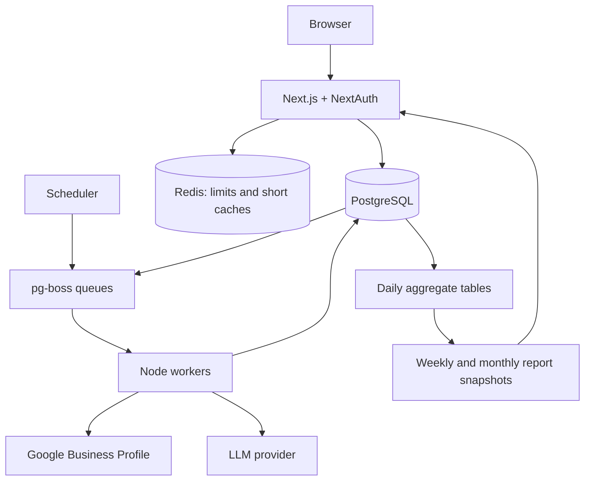

# Database architecture v2

Implementation status (27 October 2026): native Postgres, NextAuth, fresh migrations, parameterized queries, and composite tenant foreign keys are implemented on Launch. The current domain model is retained for this migration; this document's schema reorganization, persistent workers, time rollups, Redis, separate auth role, and budget reservations remain a proposed next phase. See README for the runnable setup.

Design proposal · 27 October 2026 · Broader redesign pending

## Decisions

Design for 100–1,000 stores, including stores with more than 100,000 reviews. Use a new, dedicated PostgreSQL database, NextAuth for login, a persistent Node worker, and Redis for shared rate limits and selected short-lived caches. Replace Supabase and its PostgREST access layer. Build a fresh baseline rather than preserving the current migration history or adding compatibility tables.

Postgres remains the authority for reviews, access, jobs, budgets, metrics and saved reports. Redis can be emptied without losing business data or triggering regeneration of saved LLM outputs. The application must remain usable when its result cache is unavailable.

Recommended stack:

| Component | Choice | Responsibility |
| --- | --- | --- |
| Primary database | Self-managed PostgreSQL, pinned supported major | Transactions, facts, tenant isolation, aggregates |
| Database access | Drizzle with node-postgres; reviewed SQL migrations | Typed application queries and explicit transactional SQL |
| Authentication | NextAuth with the Drizzle adapter and database sessions | User identity, account linking and revocable sessions |
| Background execution | pg-boss on the same Postgres cluster; separate Node process | Scheduling, durable jobs, retries and worker coordination |
| AI integration | AI SDK direct-provider registry behind an application service | Env-selected providers/models, structured results and central accounting |
| Redis | Shared production instance | API/provider rate limits; bounded dashboard result caching |
| Object storage | S3-compatible bucket when exports/assets need persistence | PDFs and other large artifacts, with metadata in Postgres |
| Deployment | Separate web and worker processes; DB on private network | Scale reads and background work independently |

NextAuth is the user's selected auth library. Pin and test its package/adapter versions before implementation: current Auth.js installation docs still show the Next.js beta package channel. Password recovery, SMS OTP and enterprise SSO are separate feature decisions; replacing Supabase Auth does not recreate those flows automatically. Existing login UI must expose only implemented methods.

Self-management replaces the hosted service with our own responsibility for database updates, WAL backups, restore drills and monitoring. It does not intrinsically make the same SQL query faster or prove a lower total operating cost. The main efficiency improvements below come from data layout and processing changes.

## Existing implementation findings

These are observations from repository code, not an inspection of a running database:

- `lib/services/review-observations.ts:loadObservationAggregates` downloads full observation pages into Node and aggregates them in memory. Large reports therefore scale with detailed historical observation volume.
- `lib/review-intelligence.ts:aggregateObservations` derives `reviewsAnalysed` from reviews that have observation rows. A successfully analysed written review with zero observations disappears from that denominator. Analysis coverage needs its own facts.
- Observations copy `client_id` and `group_id` from the location at processing time. Location reassignment can make these copies disagree with the current hierarchy.
- `lib/services/review-observations.ts:persistAnalysisResult` replaces observations through multiple HTTP/database operations. The new design publishes a revision and its derived facts in one database transaction.
- `grm_analysis_runs`, `grm_ai_generation_jobs` and `grm_bulk_jobs` implement separate job flows. Status polling can restart work based on elapsed silence, even while a provider request is still running.
- `lib/services/ai-usage-ledger.ts` reads a monthly counter and then writes its replacement. Concurrent requests can overwrite one another; not all LLM operations are included.
- Current migration history creates, changes, drops and rebuilds several generations of intelligence tables. `grm_location_groups`, `grm_groups` and a one-brand-per-client table overlap conceptually.
- `lib/ttl-cache.ts` and `lib/rate-limit.ts` use process memory. Other caching also exists in Next.js; these layers have different lifetimes and invalidation behavior.
- Some dashboard reads already aggregate through SQL RPCs. Preserve that principle and replace detailed historical scans with suitable read models.

## Data flow

Web requests read saved data or enqueue explicit work. Reading job status never starts or resumes processing. No database transaction is held open while calling Google or an LLM.

## Schemas and naming

Use one application database with these namespaces:

| Schema | Content | Access |
| --- | --- | --- |
| `authn` | NextAuth adapter tables | Auth adapter role; application reads approved user fields |
| `app` | Tenants, hierarchy, reviews, replies, incidents and configuration | Request role under RLS; worker role with explicit grants |
| `analytics` | Structured projections, daily metrics and report snapshots | Authorized reads; worker writes |
| `ops` | Provider credentials, processing operations, LLM calls and budgets | Restricted server/worker access |
| `pgboss` | Queue library's own tables | Queue library roles; never a client API |

Use UUID application identities and `timestamptz` for instants. Date buckets also record their reporting timezone/calendar version. Counts are `bigint`; currency is an exact numeric amount or integer microdollars. Avoid JSON arrays of review IDs, results or evidence as relational membership storage. JSONB is appropriate for versioned configuration, bounded model metadata and provider payload fragments.

For compact, high-volume observation identities, use bigint identity keys scoped by tenant in references. Do not add a second public UUID unless a product/API use requires it. Text hashes use a consistent representation; benchmark bytea versus hex text if hash indexes become material.

Every tenant-owned table carries `workspace_id`. Use composite foreign keys, such as `(workspace_id, location_id)`, to prevent cross-tenant relationships. Keep unique `(workspace_id, id)` keys on referenced tenant entities, in addition to any globally unique identifier.

## Identity, hierarchy and access

| Table | Grain / important columns | Constraints |
| --- | --- | --- |
| `authn.users` | One login identity | Adapter-compatible UUID ID; email uniqueness follows the chosen login policy |
| `authn.accounts` | One linked login provider account | Unique `(provider, provider_account_id)`; FK user |
| `authn.sessions` | One database session | Unique session token, FK user, expiry index |
| `authn.verification_tokens` | One verification challenge, if magic links are enabled | Adapter-compatible keys and expiry cleanup |
| `app.workspaces` | One tenant | Name, status, reporting timezone, access version |
| `app.workspace_members` | One user in a workspace | Unique `(workspace_id, user_id)`; enabled flag |
| `app.member_grants` | One role at one allowed scope | Member FK; role plus exactly one workspace/client/group/location target |
| `app.workspace_invites` | One invitation | Hashed opaque token, expiry, acceptance state and intended grants |
| `app.clients` | One business/organisation managed by a workspace | Composite tenant key |
| `app.groups` | One region or city within a client | Same-tenant/client parent; acyclic hierarchy; valid region/city relationship |
| `app.locations` | One logical store | Client/group FKs, IANA timezone, active state; unassigned discovery allowed explicitly |
| `app.location_tags`, `app.location_tag_links` | Tags and store assignments | Tenant-safe link uniqueness |

The workspace remains the tenant. Client → group → location remains the product's existing selector model. Preserve URL parameters `client`, `group`, `location`. A group includes descendants, but facts always attach to the store.

Use one groups table. Remove the one-to-one brand wrapper unless the product actually introduces multiple brands within a client. Multiple grants let one person manage two stores without granting the whole region. Roles define actions; grant scopes define where those actions apply.

Derive authorized store sets inside SQL from the current membership and hierarchy, rather than sending large store-ID arrays from every page. Empty authorization means no rows, never the whole workspace.

The default hierarchy attribution is **current ownership**: moving a store changes which current client/group sees its historical metrics. Daily metrics therefore store location IDs, not copied client/group IDs. If historical organisational ownership becomes a requirement, introduce effective-dated assignments and an explicit reporting mode; do not silently mix the two interpretations.

## Provider connections and synchronization

Login with Google and authorizing a business profile are separate capabilities. NextAuth accounts establish identity. Google Business Profile refresh tokens belong to restricted integration records; they must not be copied into sessions or exposed to browser code.

| Table | Grain / important columns | Constraints |
| --- | --- | --- |
| `ops.provider_connections` | One tenant's provider authorization grant | Provider subject, encrypted tokens, key version, expiry, scopes, status |
| `app.provider_accounts` | One discovered external business account | Unique tenant/provider/external account ID |
| `app.location_profiles` | One provider listing attached to a logical store | Unique tenant/provider/stable external location ID |
| `ops.connection_profile_access` | One connection able to access a listing | Unique connection/profile; same-tenant references |
| `ops.profile_sync_state` | One profile's durable sync checkpoint | Cursor, full-crawl completion marker, latest successful generation |
| `ops.sync_runs` | One crawl attempt | Mode, counts, progress checkpoint, completion and error state |

A store and its reviews survive OAuth disconnect/reconnect. Losing a connection disables synchronization; it does not cascade-delete the store. Store provider resource paths as attributes, not the sole permanent review identity when they contain mutable account paths.

Only mark a review missing after a complete, successful full crawl. Incremental, failed and truncated crawls cannot establish absence. Avoid updating a last-seen column on every unchanged review for every incremental sync. A full crawl can use bounded staging rows or a generation marker and reconcile absence once it completes.

## Reviews, revisions and intelligence

| Table | Grain / important columns | Constraints |
| --- | --- | --- |
| `app.reviews` | One provider review identity and current state | Unique `(workspace_id, profile_id, external_review_id)`; current revision pointer, location, provider creation time, source state |
| `app.review_revisions` | One observed content change | `(review_id, revision_number)` unique; content hash, stars, text, language, observed time |
| `app.review_workflow` | One review's current operational state | PK tenant/review; assignee, workflow state; independently mutable from source content |
| `app.review_events` | One assignment/status/note event | Review FK, actor, event time and bounded payload |
| `analytics.analysis_releases` | One immutable extraction/taxonomy contract | Prompt/schema/taxonomy versions, routing configuration; release key |
| `analytics.review_analyses` | One analysis of one revision under one release | Unique `(workspace_id, revision_id, release_id)`; outcome, model, processed time, observation count |
| `analytics.topics` | One canonical topic within a taxonomy | Workspace/taxonomy/key uniqueness |
| `analytics.topic_aliases` | One normalized alias mapped to a topic | Unique within workspace/taxonomy; reviewed alias resolution |
| `analytics.observations` | One distinct point in one analysis | Analysis FK, topic, sentiment, severity, quote, offsets, basis, dedupe key |
| `analytics.review_topic_facts` | One review/analysis/topic/sentiment combination | Unique `(workspace_id, analysis_id, topic_id, sentiment)`; observation count and maximum severity |
| `analytics.entities` | One canonical named entity at an explicit scope | Staff/product kind, scope and normalized key; retain original mentions |
| `analytics.observation_entities` | One entity mentioned in an observation | Unique observation/entity; tenant-safe FKs |

Keep reviewer metadata separate from the content fingerprint if name/avatar changes should not trigger extraction. A reply-only update also does not invalidate content analysis. An actual edit increments the review's revision number; a review can return to previous text and still has a distinct revision event. Reusing an earlier identical analysis is an explicit cache decision, not a revision-identity collision.

There is no unversioned competing sentiment field on `reviews`. Topic sentiment belongs to observations and the active analysis release. Mixed praise/complaints remain separate observations. Persist all validated observations; selecting dashboard highlights is a later step.

Maintain a workspace's active analysis release explicitly. Reprocessing into a new taxonomy can occur in parallel, but reports never combine incompatible releases silently. Preserve old analyses as immutable artifacts while retained; project only current revisions from the selected release into current metrics.

`review_topic_facts` is a rebuildable projection that makes unique-review topic counts inexpensive. Three billing observations in one review count as one billing review. A review can appear in positive and negative facts for the same topic; an overall topic total requires a distinct-review union, not the sum of the sentiment counts.

Do not merge staff solely by their name across every store. Entity resolution must preserve location/client context, uncertainty and aliases.

## Daily aggregate tables

Store **additive sufficient statistics**, not pre-averaged percentages. Start with daily buckets; weekly/monthly totals are SQL sums over those buckets.

| Table | Primary grain | Stored facts |
| --- | --- | --- |
| `analytics.daily_review_stats` | Tenant, location, reporting date, calendar version | Total reviews, written reviews, rating-only reviews, counts for stars 1–5, rating sum |
| `analytics.daily_analysis_stats` | Same + analysis release | Analysed written reviews including zero-observation results; pending/failed written counts; reviews with any positive/negative observation; severe-review count |
| `analytics.daily_topic_stats` | Same + analysis release, topic, sentiment | Unique review count, observation count and severe-review count |
| `analytics.daily_entity_stats` | Same + analysis release, entity, sentiment | Unique review count and observation count for staff/product views |
| `analytics.daily_reply_stats` | Tenant, location, review cohort date, calendar version | Currently replied review count and exact additive response-duration/count totals for defined reply metrics |
| `analytics.bucket_state` | Tenant, location, date, calendar version, metric family, release key | Source generation, published generation, publication time and dirty state |

Every actual table has explicit typed PK columns. The base metric families use a reserved non-null release key; avoid nullable unique-key behavior accidentally allowing duplicate buckets.

Important arithmetic rules:

- Average rating = sum of rating sums / sum of review counts. Never average store or monthly averages.
- Topic rate = unique analysed written reviews mentioning that topic and sentiment / analysed written reviews in the same window and release. Include valid analyses with no observations in the denominator.
- Show total written reviews and coverage as well. If analysis is incomplete, disclose coverage and avoid presenting the analysed subset as the whole corpus.
- Topic counts are not additive across different topics. Use dedicated any-negative/any-positive review facts for overall rates.
- Median and p95 response times cannot be recovered from daily averages. Calculate from a bounded detailed window, or add mergeable histogram statistics if the product needs these at scale.
- Reply cohort metrics answer “how many reviews received in this window are replied to now?” Reply activity metrics answer “how many replies were sent in this window?” Use separate event-time aggregates if both are shown.
- An observation's count does not become the number of customers or visits. Reviewers are a selected sample, not all store customers.

Reporting dates use an explicit IANA timezone. A report request defines its reporting calendar; do not sum store-local days and label them exact UTC/workspace-time windows. For a workspace calendar different from a store's calendar, compute alternate daily buckets on demand, or aggregate aligned UTC hourly buckets plus exact boundary slices if that feature earns its storage cost. Store-local weekly/monthly reports are the default. A calendar change invalidates/rebuilds affected buckets.

Keep rollups at location grain and join the small hierarchy to answer client/group/workspace queries. Add monthly numeric rollups only after measurements justify reducing long-range daily reads; this is separate from caching monthly narrative reports.

## Correct incremental updates

Use coalesced **dirty-bucket rebuilds** initially. Rebuilding a store/day from indexed current facts is easier to reconcile than maintaining many subtract/add counters across retries. Backfills enqueue a bounded number of bucket refreshes, not one job per observation.

1. A sync transaction writes changed review metadata/revisions, marks the relevant source and analysis buckets dirty, and enqueues necessary analysis work atomically with pg-boss's transaction integration.
2. The worker obtains the current revision and release, checks for a reusable completed result, reserves budget, then calls the provider outside the transaction.
3. Publishing the result uses a transaction: insert immutable analysis and observations, build topic facts, verify the revision is still current, mark analysis buckets dirty and complete the business operation item.
4. A bucket worker locks the bucket-state row, aggregates current committed facts and publishes **all rows in that bucket family** atomically, including clearing rows whose count became zero. It advances the published generation only for the source generation represented by that snapshot.
5. Dirty writers lock/update that same state row in the source transaction. A source change committed after the refresh snapshot leaves a later dirty generation, so it cannot be accidentally marked clean. Use a consistent lock order and retry deadlocks.
6. A report reads a consistent published generation set and its coverage/freshness markers. Publishing a report rechecks the manifest; if it changed, keep the result labelled with its original snapshot and queue a refresh rather than calling it current.

Use separate generations for review content, workflow/replies and analysis results. A reply edit must not invalidate extraction; an assignment change must not regenerate the monthly customer-feedback narrative.

If a review changes its creation date, moves profile, disappears or is restored, dirty both affected old/new buckets. Exclude removed reviews from current counts and evidence. Historical saved reports remain versioned snapshots with evidence availability markers; deletion/retention policy can require redaction separately.

A periodic SQL reconciliation compares bucket totals with source facts. A complete rebuild must be possible without paying for another extraction of unchanged reviews.

## Weekly/monthly reports and recency

| Table | Grain / important columns |
| --- | --- |
| `analytics.report_definitions` | Scope, calendar, cadence/range policy and active release; configuration, not prose |
| `analytics.report_versions` | One immutable report artifact for a definition + exact window + source-manifest hash + prompt/model configuration |
| `analytics.report_locations` | Exact store membership of a report snapshot, with hierarchy version |
| `analytics.report_bucket_versions` | Bucket identities/generations represented by a snapshot |
| `analytics.insights` | One ranked finding in a report: topic/entity, exact support/denominator, severity, direction, text and limitations |
| `analytics.insight_evidence` | One insight linked to an observation/revision; tenant-safe FKs |
| `app.insight_feedback` | User feedback on a saved finding |

The report definition can point to its latest completed artifact. A changed report creates a new artifact; do not overwrite the only explanation of a previous report. Store numeric facts relationally and bounded presentation metadata in JSONB.

Default views:

- Last 7/28 days for current operations, compared with the previous equivalent completed intervals.
- Weekly store summaries, generated only when relevant source data changed.
- Monthly management summaries from daily statistics and direct source evidence.
- A 90-day baseline; year-over-year comparisons where adequate coverage exists.
- A separate incident feed with open/resolved state.

Current incomplete periods compare with equivalent elapsed days/weekdays or are explicitly labelled provisional. Distinguish event time from ingestion time so a historical backfill cannot look like a sudden new complaint spike. Consider holidays/seasonality before interpreting a shift as deterioration.

Recency changes insight priority, not stored historical facts. A configurable decay, such as a proposed 30-day half-life, is a ranking feature. Calculate decay-weighted topic rates with matching weighted numerators and denominators, alongside exact unweighted support. Rank with prevalence, change, severity and sample reliability; do not launch with an unexplained fixed weighted sum. Evaluate rankings against representative store data first.

Do not filter to the all-time top eight topics before detecting new trends. Calculate candidate changes across all active topics, then select a bounded set after sample-size checks. Preserve one-off serious allegations separately. An unresolved incident does not disappear because its review becomes old.

Evidence selection is stratified by time, topic and sentiment and includes representative typical examples. Serious incidents have their own evidence. Select source IDs in SQL first; fetch only the bounded evidence needed for the prompt. Do not fetch thousands of quotes and discard most of them in application code.

The LLM receives computed candidate facts, limitations and a few direct quotes per candidate. It writes explanations/actions; SQL determines counts and changes. Monthly output is grounded in original facts and evidence, rather than relying only on summaries of weekly prose. Querying an arbitrary date range returns exact numeric aggregates immediately; narrative for that exact range is an explicit cached generation.

For agency/group narratives, summarize only stores the requester is authorized to see. Never return a prewritten workspace-wide narrative to a store-only user by filtering a few cards afterward. Report artifact access must account for the full underlying location set and current membership.

## Replies, incidents and supporting product features

| Domain | Tables / decisions |
| --- | --- |
| Replies | `app.replies` is current lifecycle; `app.reply_versions` preserves generated/manual candidates and edits; `ops.reply_publish_attempts` records provider outcomes and reconciliation |
| Incidents/escalations | `app.incidents`, `app.incident_events`, `app.incident_evidence`; status, assignee, severity, deadlines and resolution live independently of report snapshots |
| Automation/settings | `app.scope_policies` with explicit scope and versioned typed JSON; `app.reply_templates`, `app.knowledge_items`; resolve inheritance deterministically |
| Pause overrides | `app.automation_pauses` scoped with expiry/reason, rather than booleans copied across multiple tables |
| Notifications | `app.notifications`, `app.notification_preferences`; durable delivery attempts in `ops.deliveries` |
| Report delivery | `app.report_schedules`, `ops.deliveries`, `ops.artifacts`; delivery refers to an immutable report version |
| Review requests | `app.request_campaigns`, `app.request_campaign_locations`, `app.request_contacts`, `app.request_recipients`, `app.request_messages`, `app.request_events`, `app.request_feedback`, `app.request_qr` |
| Onboarding/branding | `app.onboarding_state`, `app.client_onboarding_links`, `app.workspace_branding`; no placeholder client invented to represent an unassigned store |
| Consent/platform admin | `app.user_consents`, `app.platform_admins`, `app.platform_invites`, `app.platform_announcements`; separate audited support-access events |
| Audit | `ops.audit_events`: actor, workspace, action, entity, time; append-only through the application role |

One authoritative reply status; a review inbox projection may cache it but cannot become a second competing state machine. Publishing uses a stable operation key and records the provider response. A timeout with an unknown provider outcome is reconciled before blind resubmission. Preserve approval rules and manual edits.

Normalize campaign recipients and per-item bulk results rather than rewriting ever-growing JSON arrays. Use unique provider-event identifiers for webhook idempotency. Scope-policy targets use explicit typed FKs and checks; avoid unconstrained `(entity_type, entity_id)` references for authorization-critical data.

## Provider-independent AI configuration

Provider and model selection is a deployment setting, with per-task overrides for extraction, replies and insight writing. Use the AI SDK provider registry with explicit direct providers behind our application service. An external gateway is not required. Business services do not import Google/OpenAI SDKs, assemble HTTP requests or parse provider responses. A new provider requires registering its adapter once; switching between supported providers/models requires only env changes and a coordinated web/worker restart.

The application service owns budget reservations, call accounting, schema/evidence validation, bounded retries and explicit fallback. Provider adapters translate capabilities and usage metadata. Provider-neutral schemas define business results. See [the AI provider architecture](AI_PROVIDER_ARCHITECTURE.md) for the env contract, routing rules, usage model and implementation boundaries.

If “Luna” means GPT-6 Luna, the provider is `openai` and the model ID is `gpt-6-luna`. It is not a separate provider. Keep API model identifiers distinct from Codex UI labels.

## Jobs, provider calls and budgets

Use pg-boss for durable queue lifecycle. Keep its schema library-owned; do not reimplement its job state in three application tables. Use named queues for sync, extraction, aggregate refresh, report synthesis, reply generation, publish, exports and notifications. Provider calls are batched where appropriate, while per-review publication remains idempotent.

Application operation tracking:

| Table | Purpose |
| --- | --- |
| `ops.operations` | One requested import/backfill/bulk action/report refresh; requester, target and progress summary |
| `ops.operation_items` | Per-entity business outcome/result; unique operation/entity/revision; references queue work where needed |
| `ops.ai_calls` | One provider attempt: operation, model/version, request ID, status, token categories, estimated cost and pricing snapshot |
| `ops.ai_route_versions` | Immutable resolved task/provider/model/options configuration; jobs pin a version without storing API keys |
| `ops.ai_call_items` | Reviews/analyses included in a batched provider call |
| `ops.ai_prices` | Effective-dated provider/model/token-category rates, including real provider batch pricing |
| `ops.ai_budget_periods` | Tenant/period limit, spent and reserved amounts |
| `ops.ai_reservations` | Idempotent budget reservation linked to a provider attempt; reconciliation state |
| `ops.provider_batches` | External asynchronous batch identity, request manifest and result-collection checkpoint |

Enqueue jobs in the same transaction as the source change. Queue de-duplication helps, but unique domain keys and compare-and-swap publication protect correctness across redelivery and job archival. Include tenant, target revision, operation and relevant configuration version in work identity. Use a bounded retry policy that distinguishes retryable transport/quota errors from permanent invalid requests.

A worker must renew its execution lease while work is active; losing ownership prevents it from publishing current state. Provider request deadlines are shorter than recoverable worker leases. Restarting a worker does not require a browser poll. Prioritize live work above backfills and use tenant-fair concurrency so one large import cannot starve other stores.

No queue can promise exactly one charge for an arbitrary external LLM call. If a worker dies after the provider accepted a request but before recording its result, the outcome can be unknown. Persist attempt IDs, use provider idempotency/result retrieval when supported, and reconcile unknown outcomes instead of automatically paying again. Budget reservations remain conservative while the outcome is unknown.

Budget control is transactional: reserve estimated upper-bound cost only when `spent + reserved + requested <= limit`. Complete/reconcile the reservation with reported usage, including thinking/cached/batch categories. Record calls even when parsing, guardrails or later database publication fails. Unknown model prices are an explicit configuration error, not zero cost. The monthly usage view is a rollup of call records; concurrent application read-then-write counters are removed.

This is an estimated spend guard, not a provider invoice guarantee; keep a margin and reconcile actual billing when available. Never regenerate a completed result simply because the Redis entry expired.

## Redis and cache contract

Use Redis in a multi-process production deployment for shared per-user, per-workspace and provider/project limits. This is more immediately useful than caching cheap indexed lookups. Keep shared provider concurrency limits separate from request rate limits. Use atomic operations, bounded expiry and owner-aware release for short-lived coordination.

Add result caching selectively:

| Data | Initial policy |
| --- | --- |
| Dashboard aggregate payload | Cache-aside, proposed 30–60s TTL with jitter; scope/range/release/calendar/version in key |
| Store/client catalog | Proposed 1–5 min; explicit hierarchy-version invalidation |
| Completed insight report | Permanent Postgres artifact; Redis may cache the artifact payload |
| Active work status | Read a compact indexed Postgres row; short cache only if polling load warrants it |
| Member permission checks | Verify current enabled membership/version; do not rely on an old cached positive authorization |
| NextAuth sessions | Postgres initially; request-local memoization to avoid repeated session reads |

Cache key shape: `v2:{workspace}:{access-fingerprint}:{scope-hash}:{range}:{calendar}:{analysis-release}:{data-generation}`. Use a stable cryptographic hash for long normalized store lists/manifests. Never omit the permission boundary or serve cross-tenant results from a shared key.

Increment committed data/hierarchy/access generations in Postgres and deliver invalidation asynchronously through the transactionally enqueued work. A small version lookup is preferable to a full historical fingerprint scan. TTL bounds dashboard staleness if invalidation is delayed. Do not treat a Redis-only version counter as authoritative.

Avoid the stale-refill race: a loader that started before a mutation must write under its old data generation, not repopulate a newly invalidated current key. Recheck source version where necessary. Coalesce hot misses with short owner-token locks; release with compare-and-delete. These cache locks do not own durable business work.

When Redis fails: fall back to Postgres for result reads with bounded concurrency; never trigger new LLM calls from a cache miss. Use a conservative database-backed limit or temporarily defer provider calls when a required shared rate limit cannot be checked. Budgets and job ownership remain protected in Postgres.

## Tenant security and database roles

The browser talks only to Next.js. Keep request, authentication, worker and migration database roles separate. The request role does not own tables, have `BYPASSRLS`, read provider tokens or administer queues.

NextAuth database sessions identify the user; current workspace membership and grants authorize access. Never trust a workspace cookie or posted scope ID without verifying membership. Support impersonation is separately audited and cannot silently grant write access.

Apply native Postgres RLS to tenant facts and scoped aggregate/report reads. Request transactions set transaction-local user/workspace context from the verified session and execute all authorized reads inside the same transaction/connection. Default missing context to denial. Do not use session-level `SET` values that can leak between pooled requests. Parameterized SQL and restricted grants are still required; application-set context assumes a trusted server, not arbitrary client SQL.

Use deliberate, indexed scope predicates; avoid recursive RLS dependencies. Composite tenant foreign keys enforce write relationships independently of authorization. RLS policies need SELECT/INSERT/UPDATE/DELETE allow/deny tests across tenant and scope boundaries. NextAuth adapter tables use their own restricted connection/role and supported custom table mapping rather than retaining Supabase's `auth.users` assumptions.

Use a bounded connection pool per web/worker process. Add PgBouncer transaction pooling if replica count/connection demand justifies it. Database operations that depend on transaction context must use one checked-out connection. Size total pool capacity across all replicas; do not give every worker an oversized pool.

## Indexing, volume and partitioning

Stress case: 1,000 stores × 100,000 reviews = **100 million reviews**. At an illustrative three observations per written review, the observation count could reach 300 million before accounting for edits/releases. Actual totals depend on written-review share and release retention. A store count alone is not a capacity measurement.

Index for observed query shapes:

| Table / workload | Initial key or index |
| --- | --- |
| Review identity | Unique `(workspace_id, profile_id, external_review_id)` |
| Store inbox | `(workspace_id, location_id, provider_created_at DESC, id DESC)`; keyset cursor includes time and ID |
| Tenant inbox | `(workspace_id, provider_created_at DESC, id DESC)` if workspace-wide paging is common |
| Workflow queue | Partial index on open work, scoped by workspace/assignee and stable ordering |
| Review revisions | Unique `(workspace_id, review_id, revision_number)`; content reuse hash index only if used |
| Analysis identity | Unique `(workspace_id, revision_id, release_id)` |
| Analysis coverage | Tenant/location/release/current review lookup supporting bucket rebuilds |
| Observations | Tenant/analysis FK lookup; `(workspace_id, location_id, topic_id, sentiment, review_created_at DESC, id DESC)` for bounded evidence |
| Review-topic facts | Unique analysis/topic/sentiment; tenant/location/date/release lookup for rebuilding buckets |
| Daily stats | Tenant/location/calendar/date (+ release/topic/sentiment dimensions as appropriate) |
| Membership | Unique `(workspace_id, user_id)` plus `(user_id, workspace_id)` for login navigation |
| Grants | Member/scoped-target indexes matched to authorization queries |
| Saved reports | Unique report/window/manifest/config identity; definition + latest completed lookup |
| LLM calls | Workspace/time/operation and provider request ID where available |

Every denormalized date/location on high-volume projections is populated through the transactional publication path and checked/reconciled against its source. Avoid many redundant indexes: each adds backfill, storage and write cost. Add text search indexes only for supported inbox searches; PostgreSQL full-text/trigram search can cover initial needs without a separate search cluster. Embeddings are a later semantic-search feature, not a prerequisite for aggregate insights.

Do not add monthly partitions to every table. Review identity needs cheap upserts and cross-table references; partitioned unique constraints must include the partition key. Keep stable identity/dimension tables unpartitioned initially. For a benchmark at tens/hundreds of millions of rows, evaluate a modest fixed hash partition count by `workspace_id` for revisions/analyses/observations; tenant-inclusive keys permit local uniqueness and tenant pruning. Select the count with representative data, not a partition per store.

Monthly range partitions suit time-retained audit/call/event history when measured retention or maintenance warrants them. Date-partitioning review identities would complicate global provider identity, old edits and FKs. Adopt it only with a measured benefit and an explicit locator/key design. Partitioning is not a substitute for aggregate read models, memory and IO capacity.

Backfill recent 90-day reviews first. Historical backfill runs below live priorities and uses true provider batch pricing when supported. Expose coverage by period. Do not report exact historical topic percentages for unprocessed or sampled history. Full older coverage can be completed over time; labels and baselines reflect what is actually processed.

## Validation before choosing server size

Seed representative distributions: many small stores, several 100k-review stores, a large agency, multilingual comments, zero-observation analyses, revisions and incident-heavy cases. Test an initial working dataset and a stress dataset approaching the intended total; synthetic rows alone do not reproduce comment size/index cost.

Measure:

1. Inbox first/next page under concurrent sync; common rating/status/text filters.
2. Last-28-day and last-12-month metrics for one store, a region and a whole agency.
3. Bucket rebuild throughput and freshness during live sync plus historical backfill.
4. Weekly/monthly synthesis candidate/evidence selection with bounded result sizes.
5. Concurrent job redelivery, worker death, unknown provider outcomes and stale-revision publication.
6. Budget reservations under concurrent calls and duplicate completion delivery.
7. RLS across tenants, two-store grants, revocation and group reassignment.
8. Redis loss and stale cache refill; no unauthorized data or duplicate paid calls.
9. Revisions/deletion/restoration, zero-count clearing, late arrivals, timezone boundaries and taxonomy cutover.
10. A fresh install, backup restore, and aggregate reconciliation after restore.

Use `EXPLAIN (ANALYZE, BUFFERS)`, `pg_stat_statements`, per-table/index sizes, worker lag, cache hit rate, DB pool wait, WAL volume and autovacuum/bloat metrics. Do not promise a hardware size or latency based only on review count. A healthy cache must not hide a broken miss path.

Deployment requires off-machine base backups plus WAL archiving/PITR and a tested restore procedure. Keep exports and backups outside the sole database disk. Queue, analysis, artifact and source-data retention have explicit policies; retained analysis releases multiply storage and should not grow without a product/debugging need.

## Replacement sequence

1. Create a new dedicated database baseline, roles, NextAuth tables and the tenant/hierarchy model. Keep old Supabase resources available only until the replacement is verified; existing data preservation is not required.
2. Introduce server-side repositories/transactions and NextAuth session helpers; replace Supabase auth calls, browser login/logout, `proxy.ts`, generated DB types and PostgREST RPC use. Preserve invite-only access, tenant suspension and scoped permissions.
3. Implement provider grants/profiles, transactional review ingestion and versioned review content. Reconnect business profiles into the new database.
4. Add pg-boss workers and idempotent operations. Move execution out of request `after()`/status polling. Wire transactional budgets/call accounting before enabling paid processing.
5. Add analysis publication, topic facts, daily aggregates and recency-aware candidate selection. Rewire inbox/dashboard/analytics to the new read paths.
6. Add immutable weekly/monthly report artifacts and bounded evidence. Rewire reply approval/publish, incidents, automation, requests, notifications and exports without dropping their product behavior.
7. Add Redis shared rate limits; enable selected result caches after measuring the uncached paths. Run capacity/concurrency/security/restore tests.
8. Remove Supabase packages, environment requirements, obsolete migrations and compatibility helpers after the app runs against the new stack. No mass-drop operation against a possibly shared old `public` schema.

This document is the architecture deliverable. It does not install packages, alter the environment file, execute migrations, drop data or replace the running application. Next.js implementation must first read the installed version's bundled guides as required by `AGENTS.md`; those guides are absent in this checkout until dependencies are installed.

## Primary references checked

- [Auth.js database session strategies](https://authjs.dev/concepts/session-strategies)
- [Auth.js Drizzle adapter and custom table mapping](https://authjs.dev/getting-started/adapters/drizzle)
- [Auth.js installation / current package channel](https://authjs.dev/getting-started/installation)
- [pg-boss transactional jobs, queues and retry features](https://github.com/timgit/pg-boss)
- [PostgreSQL 17 row security and owner bypass](https://www.postgresql.org/docs/17/ddl-rowsecurity.html)
- [PostgreSQL 17 partitioning and uniqueness limitations](https://www.postgresql.org/docs/17/ddl-partitioning.html)
- [PostgreSQL continuous archiving and point-in-time recovery](https://www.postgresql.org/docs/17/continuous-archiving.html)
- [Redis cache-aside and invalidation](https://redis.io/docs/latest/develop/use-cases/cache-aside/)
